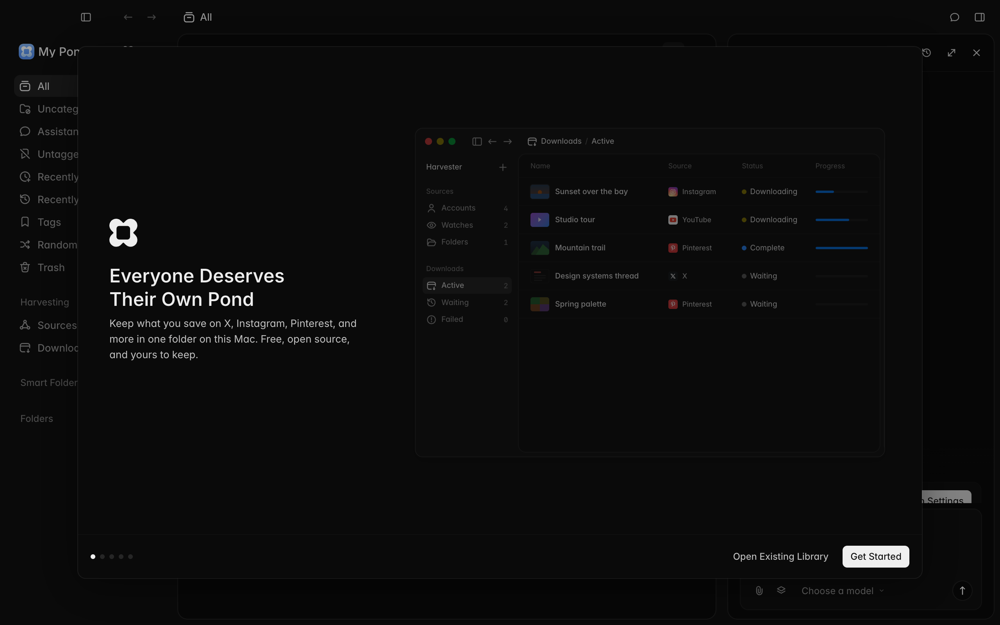
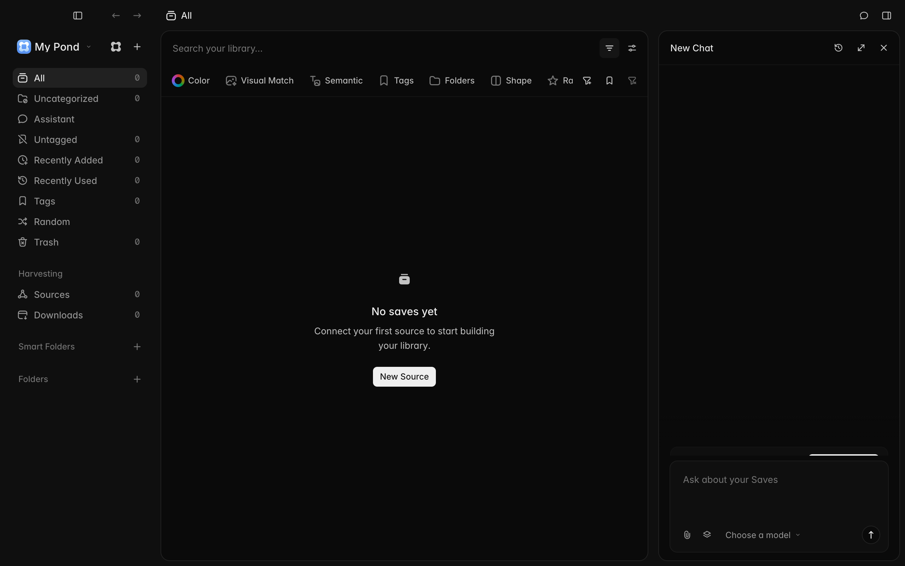
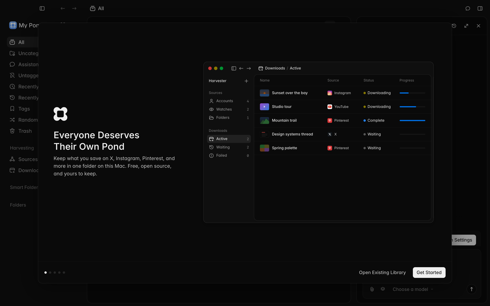

# Logs startup regression evidence

Tested code: [`282eb02b374b9750e68c34eb4cf5e40222bfd391`](https://github.com/bdsqqq/pond/commit/282eb02b374b9750e68c34eb4cf5e40222bfd391). Original code: `69a8c38a0a02f5223171f92738d3d54f126f8ae0`. This evidence-only commit is separate from the implementation PR.

On macOS arm64 with Electron 44.4.0, the original app opens normally. Denying creation of its logs directory produces an `EACCES` rejection through `resolvePaths` and opens zero windows. With the fix, the app opens and answers real `library.info` and `saves.listPage` preload queries. Blocking the fallback too leaves file logging disabled and the app usable.

The same five cases ran against production bundles and unsigned `.app` packages: original normal, original denied, fixed normal, fixed denied, and fixed with both locations blocked. All ten cases met their expected assertions. See [results](results.json), [source and artifact hashes](manifest.json), and each case's JSON and logs.

Both disposable source snapshots receive the same observer and one fixture call after sandbox setup. Removing those two insertions reproduces the exact original and fixed entrypoints. The fixture uses real `chmod 0500` permissions, isolated home/app-data/session/library paths, and the repository's synthetic local ingest-token pattern. No module mocks or user credentials were used.

## Inspected packaged-app captures

Viewport: 1280 × 800 CSS pixels. Images are the captured Retina pixels.

### Original, writable logs

### Fixed, system logs denied

The app opens and writes `app-data/logs/main.log`. The successful preload queries and log-content assertion are in the case JSON.

### Fixed, both log locations denied

The app opens with `log.transports.file.level === false`.

## Bounds and retained artifacts

The fixture source and executed orchestration scripts are retained under `harness/`; they describe the ad hoc validation, not an installed repository test command. `prepare.py` was run from the original base with the four implementation files applied in the working tree. The normal desktop build prerequisites were run before the orchestration scripts. `pnpm check` and `pnpm build` passed on the unchanged implementation source.

A normal fixed packaged capture still showed the startup cover despite the DOM readiness assertion. That image is excluded from visual proof; the two targeted permission-failure captures above show the app. Signed builds, notarization, Gatekeeper, DMG installation, Windows, and Intel macOS were not exercised.

Text artifact paths and the test hostname are redacted. Screenshot bytes and source/artifact hashes are unchanged. Full local build output, earlier failed harness attempts, and unsigned packages remain with the original validation artifacts. Keep this evidence branch while the PR or issue relies on these links; remove local scratch only after the hosted evidence has been checked.
